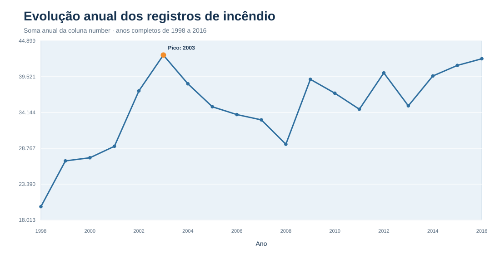
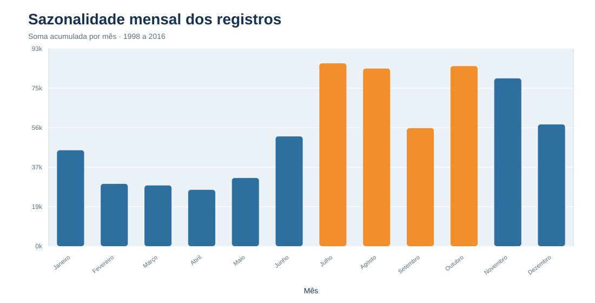

# Análise Temporal e Sazonal de Registros de Incêndio no Brasil com Python

Projeto de portfólio em **Análise de Dados com Python** focado na evolução temporal, sazonalidade e qualidade de uma base histórica de registros de incêndio entre 1998 e 2017.

## Pergunta central

**Como os registros da coluna `number` variam ao longo do tempo e entre os meses no Brasil entre 1998 e 2016, considerando as limitações de qualidade da base?**

O ano de 2017 é tratado separadamente porque contém somente janeiro a novembro.

## Dataset

A base original possui **6.454 registros**, período de **1998 a 2017**, 12 meses, 23 rótulos territoriais e nenhum valor ausente.

Após a limpeza conservadora, permanecem **6.453 registros**.

> O arquivo original do exercício não é versionado neste repositório. Consulte `data/README.md` para reproduzir a análise localmente.

## Qualidade dos dados

Dois problemas afetam diretamente a interpretação:

1. a coluna `date` registra apenas `01/01` do respectivo ano e não o mês observado;
2. alguns rótulos territoriais agrupam múltiplas séries — por exemplo, `Rio`, `Mato Grosso` e `Paraiba`.

Por isso, o projeto reconstrói `period` usando `year + month` e evita rankings estaduais que dependeriam de uma desambiguação não suportada pelo arquivo.

Também foi removida apenas uma duplicata claramente identificável: **Alagoas · Janeiro · 2017 · 38,0**.

## 1. Evolução anual

Para comparações anuais consistentes, são utilizados os anos completos de **1998 a 2016**.



Principais extremos:

- maior soma anual: **2003 — 42.760,674**
- menor soma anual: **1998 — 20.013,971**
- 2016: **42.212,229**
- variação entre 1998 e 2016: aproximadamente **+110,91%**

Essa é uma comparação descritiva e não uma estimativa causal.

## 2. Sazonalidade mensal



**Julho** apresenta a maior soma acumulada da coluna `number` entre 1998 e 2016.

Os meses de **julho a outubro** concentram aproximadamente **46,99%** da soma registrada nos anos completos.

## 3. Principais achados

- 2003 apresenta a maior soma anual entre os anos completos analisados.
- 1998 apresenta a menor soma anual.
- Julho é o mês com maior soma acumulada.
- Julho a outubro concentram cerca de 47% da soma histórica.
- Agosto de 2006 apresenta o maior agregado ano-mês.
- 2017 é parcial e não deve ser comparado diretamente aos demais anos.
- A base possui problemas de identificação territorial que impedem rankings estaduais confiáveis sem fonte adicional.

## Estrutura do projeto

```text
analise-temporal-incendios-brasil/
├── .github/workflows/python-tests.yml
├── data/
│   └── README.md
├── notebooks/
│   └── analise_temporal_incendios.ipynb
├── reports/
│   ├── figures/
│   │   ├── annual_evolution.svg
│   │   └── monthly_seasonality.svg
│   ├── methodology.md
│   └── summary.json
├── src/
│   ├── analysis.py
│   └── data_cleaning.py
├── tests/
│   └── test_data_cleaning.py
├── requirements.txt
├── pytest.ini
└── README.md
```

## Como executar

Coloque o arquivo original `Dados_Indendio.csv` em `data/source/` e execute:

```bash
pip install -r requirements.txt
python -m src.analysis
pytest -q
```

## Tecnologias

Python · Pandas · Matplotlib · Jupyter Notebook · Pytest · GitHub Actions

## Competências demonstradas

Auditoria de qualidade dos dados · tratamento conservador de duplicatas · reconstrução temporal · análise de sazonalidade · agregações anuais e mensais · documentação metodológica · testes automatizados · CI

## Limitações

- fonte primária não documentada no arquivo do exercício;
- unidade da coluna `number` não formalizada;
- rótulos territoriais ambíguos;
- coluna `date` inadequada para representar o mês;
- 2017 incompleto;
- ausência de variáveis explicativas;
- análise descritiva, sem inferência causal.

## Autor

**Pablo Sena**  
GitHub: [@pablosena28](https://github.com/pablosena28)
